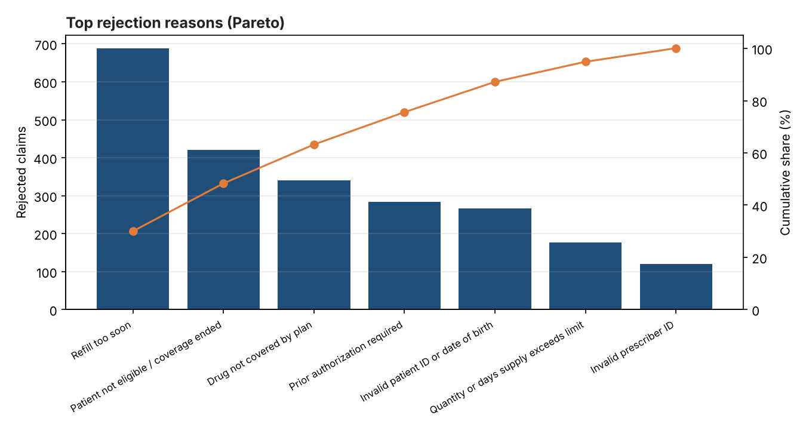
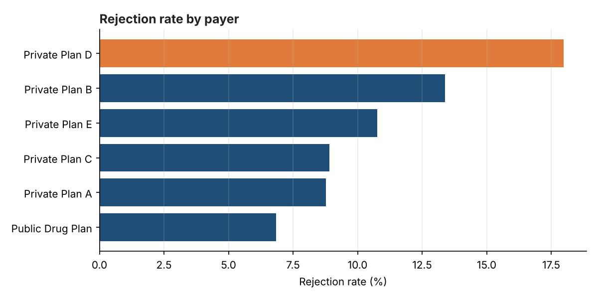
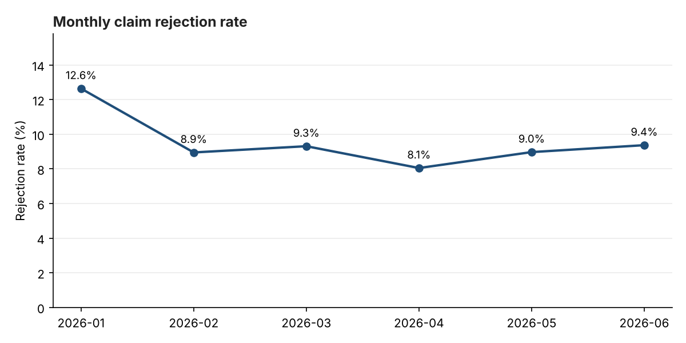
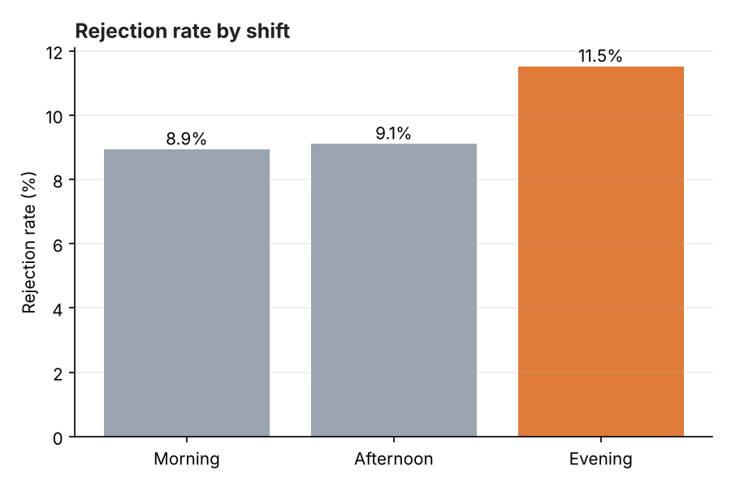

# Pharmacy Claims Rejection Analysis

An end-to-end data analytics project that finds **why pharmacy insurance claims get rejected**
and what to do about it. It covers the full analyst workflow: data quality checks and cleaning
in Python, loading into a SQL database, SQL analysis, charts, and business recommendations.

> All data is **synthetic** (generated by `src/generate_data.py`). It is modelled on real
> pharmacy workflows but contains no real patients, pharmacies or insurer data.

## Business question

Rejected claims cost a pharmacy staff time and delay patients' medications.
**Which payers, reasons, shifts and months drive rejections, and how can they be reduced?**

## Key results

| Metric | Value |
|---|---|
| Claims analyzed | 23,988 |
| Rejection rate | 9.57% |
| Rejected claims recovered after resubmission | 81.9% |
| Average days to resolve a rejection | 2.48 |

- **"Refill too soon" is the #1 reason** (30% of rejections); the top three reasons make up **63%**.
- **Private Plan D rejects 18%** of claims, versus **6.9%** for the public drug plan.
- **Evening shift rejects more** (11.5% vs 8.9% in the morning).
- **January spike** to 12.6%, consistent with plan renewals at the start of the year.

Full write-up: [`reports/findings.md`](reports/findings.md)






## Data quality

The raw file contains deliberate real-world problems. The cleaning step logs every fix
([`reports/data_quality_report.md`](reports/data_quality_report.md)):

| Check | Result |
|---|---|
| Duplicate claim IDs removed | 60 |
| Store names with wrong capitalization fixed | 25 |
| Missing payer labelled "Unknown" | 45 |
| Negative amounts corrected | 20 |
| Future dates removed | 12 |

## Project structure

```
src/generate_data.py      synthetic claims data with injected quality issues
src/clean_data.py         data quality checks, cleaning and logging
sql/schema.sql            SQLite tables, constraints and indexes
sql/analysis_queries.sql  KPI, trend, payer, reason, shift and store queries
src/analyze.py            loads SQLite, runs queries, builds charts and findings
run_all.py                runs the whole pipeline
```

## Skills shown

Python (pandas, NumPy, Matplotlib) · SQL (aggregations, window functions, joins, CASE) ·
data cleaning and validation · data modeling · KPI design · Pareto analysis ·
data visualization · turning analysis into business recommendations

## How to run

```bash
pip install -r requirements.txt
python run_all.py
```
